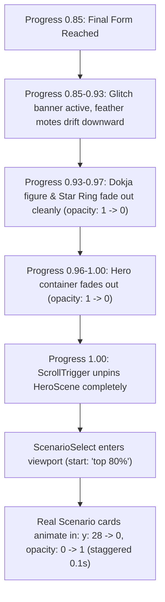

# 20 Hero & Biyoo Rebuild Structure Spec

## Overview
This specification defines the architectural and structural overhaul for the Dokja Hero Scene and the Biyoo Autonomous Companion for Phase 5. It establishes modularity, resolves all items deferred from earlier phases, cleans up architectural debt (including the 1,337-line `HeroScene.tsx` and 1,020-line `biyoo-character.tsx`), and sets strict performance, mobile, and layer budgets.

---

## 1. Current State & Audit

### 1.1 File Metrics & Responsibilities
| File | Lines | Size | Current Responsibilities |
|---|---|---|---|
| `src/components/dokja/HeroScene.tsx` | 1,337 | 51.4 KB | Monolithic container managing: auto-play intro (Stages 1-3), master pinned ScrollTrigger (Stages 4-7), reduced motion 3-frame fallback, DOM for 10 visual layers, inline SVG paths, deterministic starfield generators, mock shatter grid tiles, glitch notification HUD, Biyoo companion mounting, reader tracker listeners, fast-forward wheel/touch listeners, and window resize hooks. |
| `src/components/dokja/hero-context.tsx` | 43 | 1.3 KB | Minimal React context holding `stage` (1-7), `scrollProgress` (0-1), and `introDone` (boolean). |
| `src/components/dokja/particles-data.ts` | 129 | 7.0 KB | 120 deterministic particle coordinate objects. |
| `src/components/dokja/dokja-placeholder.tsx` | 232 | 9.1 KB | Deprecated standalone vector placeholder (orphaned code). |
| `src/components/biyoo/biyoo-character.tsx` | 1,020 | 35.6 KB | Monolithic companion component mixing state machine transitions, mouse-following requestAnimationFrame lerp, 8 separate GSAP timelines in a switch statement, loose window event dispatches, costume slot logic, interactive click/poke handler, speech bubble DOM, and a 300+ line inline SVG drawing. |
| `src/components/biyoo/biyoo-state.ts` | 70 | 1.4 KB | Type definitions (`BiyooState`, `BiyooCostume`) and metadata config table (`BIYOO_STATES_CONFIG`). |
| `src/components/biyoo/biyoo-placeholder.tsx` | 163 | 6.8 KB | Phase 0 legacy placeholder component (orphaned code). |
| `src/components/biyoo/corner-bounty-button.tsx` | 172 | 6.6 KB | Fixed bottom-right link to `/wanted` with mini Biyoo icon, safe-area positioning, and hero transformation hide listener. |
| `src/lib/reader/use-constellation.ts` | 385 | 13.5 KB | Constellation broadcast engine reading visitor signals (idle, scroll speed, section observer). |
| `src/lib/reader/constellation-overlay.tsx` | 89 | 3.4 KB | Floating teal HUD presentation component for Constellation broadcasts. |
| `src/lib/reader/constellation-global-layer.tsx` | 54 | 1.7 KB | Global mount that suppresses Constellation broadcasts when `isBiyooSpeaking` is true. |
| `src/components/finale/dokja-finale-figure.tsx` | 284 | 11.8 KB | Act 6 standalone Dokja vector figure, re-implementing an independent duplicate of the character and wing SVG paths. |

### 1.2 Problems Listed in DEFERRED.md & Discovered Audit Items
1. **Ghost tiles behind Dokja near the end of hero scroll (`docs/DEFERRED.md`)**:
   - `HeroScene.tsx` (lines 1341-1356) contains a mock `.hero-shatter-grid` with 6 hardcoded dummy cards (`SCENARIO_01` to `SCENARIO_06`) that animate to `opacity: 1` during Stage 7 (scroll 85%-95%).
   - Immediately below the pinned hero in `src/app/page.tsx` sits `<ScenarioSelect />`, which renders real project cards.
   - When the hero is pinned at the end of scroll or transitioning, the mock shatter tiles float directly over or behind Dokja and conflict with the real Scenario cards beneath, creating duplicate "ghost tiles".
2. **Broken wing art (`docs/DEFERRED.md`)**:
   - The current wings are coarse vector paths (`M 140 160 C 100 110...`) using generic quadratic beziers.
   - They do not match the multi-layer feathered wings specified in `docs/06` and `docs/08`. They lack realistic feather silhouettes, layered primary and secondary flight feathers, shoulder-blade depth, and natural spreading articulation.
3. **Mobile hero overlaps (`docs/DEFERRED.md`)**:
   - On compact mobile viewports (360x740, 390x844), 4 floating elements collide:
     - Top System Notification (`top-20 right-4`) overlaps Dokja's head and horns.
     - Glitch Notification (`top-24`) collides with the system notification area.
     - SCROLL Hint (`bottom-4 inset-x-0 mx-auto`) collides with Biyoo's right edge and the mobile home indicator.
     - Biyoo companion (`bottom-4 left-3`, size 115px) + speech bubble (`-top-16`) overlaps Dokja's legs and the bottom scroll hint.
4. **SCROLL hint issues**:
   - Positioned at `bottom-4 sm:bottom-6`, competing directly with iOS Safari home indicators and Android navigation bars.
   - Handled via direct inline style mutations (`(scrollHint as HTMLElement).style.opacity = "0"`) mixed with GSAP timeline tweens, causing visual pops when scrubbing backward.
5. **Biyoo cropping**:
   - `HeroScene.tsx` enforces `overflow-hidden` and `overflow-x-clip`. When Biyoo triggers a speech bubble (`-top-16 left-0`), the speech box clips at the viewport boundary.
   - During bounce and jump animations (`y: -24px`), Biyoo's horns and ears clip against the companion container boundaries.
6. **1,400-line monolithic HeroScene**:
   - `HeroScene.tsx` (1,337 lines) bundles auto-play choreography, scroll scrub choreography, reduced motion DOM, inline SVG assets, and particles into one unmaintainable file.
7. **[FOUND] Monolithic 1,020-line Biyoo Component (`biyoo-character.tsx`)**:
   - Blends animation loops, requestAnimationFrame pointer math, speech state, audio event dispatching, and 300+ lines of raw SVG markup in a single file.
8. **[FOUND] Uncoordinated Dual Speech (Biyoo vs. Constellation)**:
   - While `ConstellationGlobalLayer` watches `isBiyooSpeaking` to withhold Constellation messages, Biyoo can trigger speech while a Constellation message is already displayed. This leads to two floating text boxes on screen simultaneously, violating the "one voice at a time" principle.
9. **[FOUND] Audio Context Bypass & Event Decoupling**:
   - Biyoo triggers sound by dispatching un-typed global DOM custom events (`biyoo:sound`) rather than directly consuming the established `useSound()` context hook (`src/lib/sound/sound-context.tsx`).
10. **[FOUND] Fast-Forward Jump Glitches**:
    - The passive wheel/touch listeners in `HeroScene.tsx` force `introTimelineRef.current.timeScale(8)`, causing visual snapping and out-of-order tweens if triggered while user scrolls during Stage 2.
11. **[FOUND] Redundant DOM In Reduced Motion Mode**:
    - Both `#hero-scene-reduced` and `#hero-scene` exist in the DOM simultaneously with CSS `display: none`/`display: flex` to bypass pin-spacer recalculations, inflating the initial DOM by ~200 extra elements.
12. **[FOUND] Character & Wing Art Duplication Across Acts**:
    - `dokja-finale-figure.tsx` in Act 6 duplicates the character figure and wings with separate inline SVG definitions instead of sharing a canonical character model with Act 1.

---

## 2. Target Module Structure for the Hero

### 2.1 File Organization & Responsibilities (Max 250 Lines Per File)
```text
src/components/dokja/
├── index.ts                         # Public exports (< 30 lines)
├── hero-context.tsx                 # State context & progress types (< 80 lines)
├── HeroOrchestrator.tsx             # Root container, pinned ScrollTrigger & stage coordinator (< 220 lines)
├── DokjaFigure.tsx                  # Pure character SVG/sprite renderer with ref hooks (< 230 lines)
├── hero-layers.tsx                  # Background gradient, 3-layer starfield, particles (< 200 lines)
├── hero-hud.tsx                     # System window toast, glitch banner, scroll hint (< 190 lines)
├── stages/
│   ├── stage-1-reading.ts           # Auto-play: coat sway, hair breath, phone glow (< 110 lines)
│   ├── stage-2-notices.ts           # Auto-play: eyes shift, phone lowers, toast appears (< 120 lines)
│   ├── stage-3-irritation.ts        # Auto-play: brow tightens, sigh scale, scroll hint pulses (< 130 lines)
│   ├── stage-4-horns.ts             # Scroll 0-25%: horns grow, red rim light fades in (< 120 lines)
│   ├── stage-5-wings-emerge.ts      # Scroll 25-55%: shoulder pivots, wings unfold (< 160 lines)
│   ├── stage-6-wings-expand.ts      # Scroll 55-85%: wings pass edges, star ring orbits (< 160 lines)
│   └── stage-7-final-form.ts        # Scroll 85-100%: glitch alert, feather drift, clean handoff (< 170 lines)
└── hero-reduced.tsx                 # Clean, accessible static overview for reduced-motion (< 180 lines)
```

### 2.2 Ref Architecture & Timeline Delegation
- **Orchestrator Ownership**: `HeroOrchestrator.tsx` owns the pinned DOM container (`#hero-scene-pinned`), creates the master GSAP scroll timeline, and initializes the pinned `ScrollTrigger` (`pin: true, anticipatePin: 1, scrub: 0.6`).
- **Figure Ref Interface**: `DokjaFigure.tsx` exposes a single ref handle `DokjaFigureRefs`:
  ```typescript
  export interface DokjaFigureRefs {
    container: React.RefObject<HTMLDivElement | null>;
    body: React.RefObject<SVGGElement | null>;
    coat: React.RefObject<SVGGElement | null>;
    hair: React.RefObject<SVGGElement | null>;
    eyesReading: React.RefObject<SVGGElement | null>;
    eyesNotice: React.RefObject<SVGGElement | null>;
    browIrritated: React.RefObject<SVGGElement | null>;
    horns: React.RefObject<SVGGElement | null>;
    hornsRedRim: React.RefObject<SVGGElement | null>;
    wingBackL: React.RefObject<SVGGElement | null>;
    wingBackR: React.RefObject<SVGGElement | null>;
    wingFrontL: React.RefObject<SVGGElement | null>;
    wingFrontR: React.RefObject<SVGGElement | null>;
    phone: React.RefObject<SVGGElement | null>;
    phoneGlow: React.RefObject<SVGGElement | null>;
  }
  ```
- **Stage Registration Function Signature**:
  Each stage module exports a pure builder function:
  ```typescript
  export function registerStage(
    tl: gsap.core.Timeline,
    refs: DokjaFigureRefs,
    hudRefs: HeroHudRefs,
    options: { mode: "full" | "light"; isTouch: boolean }
  ): void;
  ```
  Stage files do not instantiate `ScrollTrigger` or manage component state; they append tweens to specific position markers along the master timeline.

### 2.3 Explicit Layer Map & Z-Index Table
| Layer | Element / Selector | Z-Index Token | Numeric Z | Owner Component | Description |
|---|---|---|---|---|---|
| 0 | `<SiteWall />` | `--z-wall` | `0` | Root Layout | Global dark site background wallpaper |
| 1 | `.hero-bg-radial` | local | `1` | `HeroLayers` | Teal/void ambient radial gradient |
| 2 | `.hero-stars-parallax` | local | `2` | `HeroLayers` | 3 deterministic star layers (L1-L3) |
| 3 | `.hero-star-ring` | local | `3` | `HeroLayers` | Dashed constellation ring with orbiting nodes |
| 4 | `.dokja-wing-back` | local | `4` | `DokjaFigure` | Back wing feathers (L & R), shoulder pivot |
| 5 | `.dokja-body` | local | `5` | `DokjaFigure` | Undersuit, legs, boots, neck, face |
| 6 | `.dokja-coat` | local | `6` | `DokjaFigure` | White trench coat with cold rim light & sway |
| 7 | `.dokja-horns` & `.dokja-horns-rim` | local | `7` | `DokjaFigure` | Red-black horns and dedicated red rim stroke |
| 8 | `.dokja-wing-front` | local | `8` | `DokjaFigure` | Front wing feathers (L & R), shoulder pivot |
| 9 | `.dokja-phone` | local | `9` | `DokjaFigure` | Phone device, screen text, fingers |
| 10 | `.dokja-phone-glow` | local | `10` | `DokjaFigure` | Cold cyan ambient light cast |
| 11 | `.hero-particles` | local | `11` | `HeroLayers` | Floating stardust motes (capped by mode) |
| 12 | `.hero-feather-drift` | local | `12` | `HeroLayers` | Drifting feather motes bridging to Scenario Select |
| 20 | `.hero-system-window` | local | `20` | `HeroHud` | "A Reader has been detected" toast |
| 20 | `.hero-scroll-hint` | local | `20` | `HeroHud` | Pulsing bottom scroll prompt |
| 25 | `.hero-glitch-banner` | local | `25` | `HeroHud` | "A Scenario has arrived" glitch alert |
| 35 | `<BiyooCompanion />` | `--z-biyoo` | `35` | Global Layout | Floating companion, autonomous state machine |
| 40 | `<CornerBountyButton />` | `--z-bounty` | `40` | Global Layout | Bottom-right fixed link to `/wanted` |
| 50 | `<ConstellationOverlay />` | `--z-overlay` | `50` | Reader Layer | Floating teal Constellation broadcast HUD |
| 50 | `<header>` | `--z-overlay` | `50` | Root Layout | Sticky navigation bar |
| 100 | `#skip-link` | `--z-skip` | `100` | Root Layout | Accessible keyboard skip link |

---

## 3. Target Structure for Biyoo

### 3.1 Architectural Modularization
```text
src/components/biyoo/
├── index.ts                         # Public exports (< 30 lines)
├── biyoo-machine.ts                 # Pure deterministic state machine (< 120 lines)
├── biyoo-types.ts                   # State, event, costume, and animation types (< 70 lines)
├── biyoo-renderer.tsx               # Visual companion renderer (< 210 lines)
├── biyoo-speech.tsx                 # Mini SystemWindow speech bubble with safe bounds (< 140 lines)
├── costume-registry.tsx             # World costume prop overlays (< 160 lines)
├── reaction-map.ts                  # Trigger -> state -> line -> sound map (< 90 lines)
├── corner-bounty-button.tsx         # Persistent bounty board shortcut (< 150 lines)
└── use-biyoo-audio.ts               # Hook connecting Biyoo to useSound context (< 80 lines)
```

### 3.2 Pure State Machine (`biyoo-machine.ts`)
- Pure state reducer: `(current: BiyooState, event: BiyooEvent) => BiyooStateTransition`.
- Completely decoupled from React render cycles and DOM mutations.
- **States**:
  1. `sleeping`: Initial state upon arrival. Gentle breathing bob.
  2. `yawn-wake`: Triggered after 8s idle. Stretch, yawn, nudge screen.
  3. `startled`: Triggered at Stage 7 (85% scroll). Jump, squeak.
  4. `curious`: Triggered by card hover or interactive poke. Head tilt, lean.
  5. `happy`: Triggered by scenario selection or proof confirmation. Bounce.
  6. `proud`: Triggered when reading proof/test result. Chest puff.
  7. `sleepy-again`: Triggered after 60s idle. Droop.
  8. `night`: Triggered if visitor local hour is 00:00-04:59. Rubbing eyes.
- **Throttling & Guard Rules**: State transitions to emotional states (`curious`, `happy`) are debounced to a maximum of once every 1,500ms. Idle nudge triggers exactly once per session.

### 3.3 Real Art Renderer (`biyoo-renderer.tsx`)
- Sourced from approved reference art `docs/reference/biyoo/biyoo-01.png` and `biyoo-02.png`:
  - **Body**: Spherical fluffy cotton texture with soft tufted edges. Soft warm rim light along contours.
  - **Horns**: Two small curved cone horns with amber-gold coloration and spiraling ridges (strictly no red).
  - **Face**: Upward curved closed eye arcs (`^^`), laughing open mouth with inner pink tongue, and soft rosy blush lines.
  - **Limbs**: Two rounded nubs for arms, two stubby feet.
- Transitions between eye variants (`sleepy`, `awake`, `wide`) and mouth variants (`smile`, `yawn`, `droop`) are handled by opacity swaps of sub-vector groups.
- Scaled dynamically using CSS: `clamp(72px, 10vw, 110px)`.

### 3.4 Costume Registry (`costume-registry.tsx`)
Overlay prop definitions positioned with precise anchor coordinates:
- `star goggles`: Edge-Cloud world (teal wireframe goggles with star-shaped lenses).
- `headband`: Raft world (leaf-village style green headband with parchment emblem).
- `chain bracelet`: Z3 world (dark Nen chain wrapped around Biyoo's left arm nub).
- `magnifier`: Backtrace world (brass-rimmed detective magnifying glass held by right arm nub).
- `none`: Default appearance.

### 3.5 Shared Speech Queue (`src/lib/reader/speech-queue.ts`)
To ensure **one voice at a time**:
- Central priority queue shared between Biyoo and the Constellation layer.
- **Priority Hierarchy**:
  1. *Priority 1 (Critical System)*: Stage 2 "A Reader has been detected", Stage 7 "A Scenario has arrived."
  2. *Priority 2 (Biyoo Direct)*: Interactive user responses ("Good choice.", "Evidence found.", "Scroll, reader.").
  3. *Priority 3 (Ambient Constellation)*: Periodic channel broadcasts from `useConstellationEngine`.
- **Arbitration Policy**:
  - When Biyoo initiates speech, any active Constellation broadcast immediately fades out (200ms) and yields the screen.
  - While Biyoo's speech bubble is active, all Constellation broadcasts are queued or dropped.
  - Biyoo speech auto-hides after 4,000ms (or 2,000ms on fast scroll).

### 3.6 Sound Integration via Existing Sound Context
- Replace disconnected `window.dispatchEvent(new CustomEvent("biyoo:sound"))` with `useBiyooAudio` hook:
  ```typescript
  import { useSound } from "@/lib/sound/sound-context";

  export function useBiyooAudio() {
    const { playSound, stopSound } = useSound();
    return {
      playPat: () => playSound("pat"),
      playSqueak: () => playSound("squeak"),
      playYawn: () => playSound("yawn"),
      playChirp: () => playSound("chirp"),
      playBoing: () => playSound("boing"),
      startBreathing: () => playSound("breath"),
      stopBreathing: () => stopSound("breath"),
    };
  }
  ```
- All sound playback respects the user's sound permission preference and tab visibility automatically.

---

## 4. Scroll Budget per Stage & Section Handoff

### 4.1 Scroll Budget Allocation
Total pinned scroll travel:
- **Desktop**: `300vh` (3x viewport height).
- **Mobile / Touch**: `200vh` (2x viewport height to prevent thumb fatigue).

| Stage | Name | Timeline Trigger | Scroll Range (%) | Desktop Budget | Mobile Budget | Key Actions |
|---|---|---|---|---|---|---|
| **Stage 1** | Reading | Auto-play on arrival | 0.0s – 2.5s | 0vh (time-based) | 0vh (time-based) | Coat subtle sway, hair loop, phone cold glow. Eyes downcast. |
| **Stage 2** | Notices You | Auto-play on arrival | 2.5s – 5.0s | 0vh (time-based) | 0vh (time-based) | Eyes lift to viewer, phone lowers 12px, system notification toast. |
| **Stage 3** | Irritation | Auto-play on arrival | 5.0s – 7.2s | 0vh (time-based) | 0vh (time-based) | Brow tightens, small sigh scale, cold glow flare, SCROLL hint pulses. |
| **Stage 4** | Horns Grow | Scroll-scrubbed | **0% – 25%** | 75vh | 50vh | SCROLL hint disappears immediately (at 0.5%). Horns scale 0.45 -> 1.15. Red rim light fades 0 -> 1. |
| **Stage 5** | Wings Emerge | Scroll-scrubbed | **25% – 55%** | 90vh | 60vh | White wings unfold from shoulder pivots. Back and front layers rotate/scale with heavy easing. |
| **Stage 6** | Wings Expand | Scroll-scrubbed | **55% – 85%** | 90vh | 60vh | Wings expand past screen edges. Orbiting Constellation star ring fades in and rotates 180°. |
| **Stage 7** | Final Form & Drift | Scroll-scrubbed | **85% – 100%** | 45vh | 30vh | Glitch banner "A Scenario has arrived." Biyoo squeaks. Wings shatter into drifting feather motes. |

### 4.2 Exact Handoff from Hero to Scenario Select
The transition must completely eliminate ghost tiles and sudden DOM pops:



- **Ghost Tile Removal**: The mock `.hero-shatter-grid` and mock cards (`SCENARIO_01` to `SCENARIO_06`) are deleted entirely from the hero component.
- **Feather Bridge**: In Stage 7, 12 to 18 white feather sprites drift downward across the bottom edge of the viewport. As they drift down, Dokja fades out (`opacity: 0` at 97%).
- **Unpinning**: The pinned hero container reaches `opacity: 0` at progress 1.0. When unpinned, document scroll immediately reveals `<ScenarioSelect id="scenario-select" />`.
- **Entrance**: Scenario Select triggers its own entrance animation (`gsap.from(".scenario-card-item", { y: 28, opacity: 0, stagger: 0.1 })`), ensuring only the authentic scenario cards ever appear.

---

## 5. Mobile Rules (360x740 and 390x844 Viewports)

### 5.1 Viewport Targets & Safe Insets
- **Android Target**: `360px × 740px` (Samsung Galaxy A-series / standard modern Android).
- **iOS Target**: `390px × 844px` (iPhone 12/13/14/15 base portrait).
- **Top Safe Zone Exclusion**: `env(safe-area-inset-top, 0px) + 52px` (header height). Total: ~88px to 100px.
- **Bottom Safe Zone Exclusion**: `env(safe-area-inset-bottom, 0px) + 44px` (home indicator / nav bar). Total: ~48px to 64px.
- **Usable Middle Stage**: Y = 100px to Y = 620px (on 740px height) / Y = 680px (on 844px height).

### 5.2 Non-Overlapping Spatial Coordinates
```text
+-------------------------------------------------------------+  Y = 0
| [Sticky Header: SUMIT MAHAJAN             Mode Sound Skip]  |  Y = 52px
+-------------------------------------------------------------+
|                                                             |
|           [System Notification / Glitch Banner]             |  Y = 64px - 110px
|           (max-w-[260px], centered horizontally)            |
|                                                             |
|                                                             |
|                     +-----------------+                     |  Y = 130px
|                     |   DOKJA FIGURE  |                     |
|                     |   w: 230-250px  |                     |
|                     |   h: 310-330px  |                     |
|                     +-----------------+                     |  Y = 460px
|                                                             |
|                                                             |
|                                       [SCROLL Hint]         |  Y = 580px - 610px
|                                       (center, hidden >0%)  |
|                                                             |
|  [Biyoo: 80px]                                 [Bounty Btn] |  Y = 640px - 720px
|  (bottom-left)                                 (bottom-right|
+-------------------------------------------------------------+  Y = 740px / 844px
```

### 5.3 Mobile Placement Rules
1. **Dokja Figure**:
   - Mobile dimensions: `width: 240px`, `height: 320px` (scaled down from desktop 360x440).
   - Centered vertically and horizontally in the middle safe zone.
   - Horns top edge sits at Y ≈ 130px; boots bottom edge sits at Y ≈ 450px.
2. **Top System Notification & Glitch Alert**:
   - Position: `top: calc(56px + env(safe-area-inset-top, 0px))`, horizontally centered (`left: 50%, transform: translateX(-50%)`).
   - Width clamped to `max-w-[260px]`.
   - Never overlaps Dokja's horns (ends at Y = 110px, Dokja begins at Y = 130px).
3. **Biyoo Companion**:
   - Fixed at bottom-left: `left: calc(12px + env(safe-area-inset-left, 0px))`, `bottom: calc(12px + env(safe-area-inset-bottom, 0px))`.
   - Scaled down to `size = 80px` on screens < 400px wide.
   - Speech bubble positioned strictly above Biyoo: `bottom: 100%`, `left: 0`, `max-w-[170px]`. Will not extend past screen center or clip viewport left edge.
4. **Corner Bounty Button**:
   - Fixed at bottom-right: `right: calc(12px + env(safe-area-inset-right, 0px))`, `bottom: calc(12px + env(safe-area-inset-bottom, 0px))`.
   - Size: 40px × 40px circular touch target (meets 44px touch target via 4px invisible padding).
   - Hidden (`opacity: 0, pointer-events: none`) while hero scroll progress is between 0% and 95% to keep mobile screen uncluttered during wing expansion.
5. **SCROLL Hint**:
   - Centered horizontally: `left: 50%, transform: translateX(-50%)`.
   - Vertical position: `bottom: calc(68px + env(safe-area-inset-bottom, 0px))`.
   - Sits in the clear horizontal gap between Biyoo (X: 12px to 92px) and the Bounty Button (X: 308px to 348px). Clear horizontal margin on both sides: > 35px.
   - At scroll progress > 0.005, set `opacity: 0` and `pointer-events: none` instantly.

---

## 6. Performance Budget

### 6.1 ScrollTrigger & Scene Limits
- **Max ScrollTriggers Across Full Page**: Strictly capped at **6 instances**:
  1. `HeroScene`: 1 master timeline trigger (`pin: true, scrub: 0.6`).
  2. `ScenarioSelect`: 1 entrance trigger (`once: true, start: "top 80%"`).
  3. `EdgeCloudWorld`: 1 world timeline trigger.
  4. `RaftWorld`: 1 world timeline trigger.
  5. `Z3World`: 1 world timeline trigger.
  6. `FinaleSection`: 1 finale trigger.
- All triggers must register inside `useScene` scopes and automatically call `.kill()` on component unmount.

### 6.2 Animated Layer Caps
- **Max Concurrently Animating Layers in Hero**: **8 layers** during Stages 5 and 6 (Back Wings L/R, Front Wings L/R, Coat Sway, Star Ring Orbit, Red Rim Opacity, Particle Float).
- Zero JavaScript-driven RAF coordinate recalculations during scroll (GSAP timeline scrub executes via native compositor-backed transforms).

### 6.3 Particle Budgets
| Mode | Particle Cap | Implementation |
|---|---|---|
| **Full Mode (Desktop)** | **120 motes** | CSS `will-change: transform`, deterministic coordinates from `particles-data.ts`. |
| **Full Mode (Mobile)** | **40 motes** | Top 40 particles sliced from data. Lightweight CSS pulse. |
| **Light Mode** | **15 motes** | 15 static motes with simplified CSS opacity shimmer. |
| **Reduced Motion** | **0 motes** | Completely omitted from DOM. |

### 6.4 Strict Compositing & GPU Rules
- **Properties Allowed for Animation**: `transform` (`translate3d`, `scale`, `rotate`) and `opacity` only.
- **Forbidden Properties**: Never animate `top`, `left`, `width`, `height`, `margin`, `padding`, or `border`.
- **Zero Animated SVG Filters**: Animated `feGaussianBlur`, `feTurbulence`, or dynamic CSS `filter: drop-shadow(...)` are strictly prohibited on mobile.
- **Red Rim Light**: Implemented as a separate SVG path element (`stroke="#B3122B"`) with tweened `opacity: 0 -> 1`, avoiding all runtime filter computations.
- **will-change Strategy**: Applied only to active animated elements (`.hero-dokja-figure`, `.dokja-wing-back-l`, etc.) and stripped once unpinned or idle.

---

## 7. Test Plan

### 7.1 Scroll Percentage Test Matrix
Verify pixel rendering, alignment, and state transitions at these exact scroll positions:
| Scroll % | Target Stage | Expected Visual Verification |
|---|---|---|
| **0.0%** | Stage 1 / 4 Start | Dokja standing steady reading phone, cold cyan glow on face, hair and coat micro-swaying. Biyoo sleeping. Horns scaled down to 0.45. SCROLL hint visible. |
| **12.5%** | Stage 4 Midpoint | Horns halfway grown (scale ~0.8), red rim light semi-visible (opacity ~0.5). SCROLL hint completely invisible. Phone starting to lower. |
| **25.0%** | Stage 4 End / 5 Start | Horns fully grown (scale 1.15) with crisp red rim light. Wings beginning to emerge from shoulder pivots. |
| **40.0%** | Stage 5 Midpoint | Wings unfolded halfway, distinct back and front feather layers visible. Biyoo undisturbed. |
| **55.0%** | Stage 5 End / 6 Start | Wings fully unfolded to body width. Constellation star ring begins fading in. |
| **70.0%** | Stage 6 Midpoint | Wings extending past screen edges. Star ring rotated 90°. Stardust particles floating. |
| **85.0%** | Stage 7 Start | Glitch text banner appears: "A Scenario has arrived." Biyoo enters `startled` state (squeak sound triggered). Wings begin feather shatter drift. |
| **95.0%** | Stage 7 Midpoint | Dokja figure and star ring fading out (opacity ~0.3). White feather motes drifting toward screen bottom. Zero ghost cards visible. |
| **100.0%** | Handoff / Unpinned | Hero scene container fully unpinned and faded. Scenario Select visible with authentic cards entering smoothly (`y: 28 -> 0`). |

### 7.2 Viewport Coverage Matrix
1. **Mobile Small (`360 × 740`)**: Android small screen test. Confirm 0px overlap between Biyoo, SCROLL hint, Bounty button, and notification.
2. **Mobile Standard (`390 × 844`)**: iPhone portrait test. Verify notch and home indicator clearance with `env(safe-area-inset-*)`.
3. **Tablet (`768 × 1024`)**: iPad portrait. Confirm wing expansion spans across the wider canvas without clipping.
4. **Desktop Standard (`1440 × 900`)**: Standard MacBook / 14" laptop. Verify 60fps scrub smoothness.
5. **Desktop Wide (`1920 × 1080`)**: Full HD desktop. Verify wing tips cleanly cross full screen bounds.

---

## 8. Open Decisions

### Decision 1: Asset Format for Dokja Character & Wings
- **Question**: Should Dokja's final character and wing art be rendered as layered raster WebP/AVIF sprites with alpha channels or as complex SVG paths?
- **Recommended Answer**: **Layered WebP/AVIF sprites with SVG bounding boxes**. WebP/AVIF allows genuine painterly textures, feather gradients, and rim lighting without SVG path complexity or DOM rendering bottlenecks on mobile.

### Decision 2: Feather Shatter Visual Mechanics in Stage 7
- **Question**: Should the Stage 7 wing "shatter" dissolve into abstract falling white feather motes that fade as Scenario Select enters, or should individual shattered tiles physically fly into the exact coordinates of the Scenario Select cards?
- **Recommended Answer**: **Drifting feather motes that fade downward as Scenario Select enters**. Coordinating flying tiles across a pinned 100svh container boundary into an unpinned dynamic grid introduces brittle layout calculations across breakpoints. Falling feather motes deliver the story narrative ("feathers drift into page grid") cleanly without layout bugs.

### Decision 3: Global Companion vs. Hero-Local Biyoo Mounting
- **Question**: Should Biyoo be mounted as a single persistent global component in `src/app/layout.tsx` or remain mounted inside `HeroScene` and re-mounted across other sections?
- **Recommended Answer**: **Single persistent instance in `src/app/layout.tsx` (or a persistent global companion layer)**. Mounting Biyoo inside `HeroScene` caused container clipping and unpinning disappearance. A single persistent companion with safe-area offsets remains visible and consistent across all acts.

### Decision 4: Scrub Sound Trigger Policy at Stage 7 Boundary
- **Question**: When a visitor rapidly scrubs forward and backward across the 85% scroll threshold (Stage 7), how should the Biyoo startled squeak and glitch sound be triggered?
- **Recommended Answer**: **Debounce / one-shot per scroll direction with a 5-second cooldown**. Prevents rapid audio stuttering ("machine gun" sound triggers) if the visitor scrubs back and forth across the 85% scroll threshold.

### Decision 5: Reduced Motion Implementation Strategy
- **Question**: For `prefers-reduced-motion`, should we keep the current 3-frame vertical stacked layout or use a single static hero card showing Stage 1 that crossfades into Stage 7 on scroll?
- **Recommended Answer**: **A single static Stage 1 reading hero that crossfades directly to the Scenario Select grid on scroll**. The current 3-frame stacked layout triples the page height and duplicates Dokja 3 times. A single clean frame respects reduced motion better and eliminates DOM bloat.
